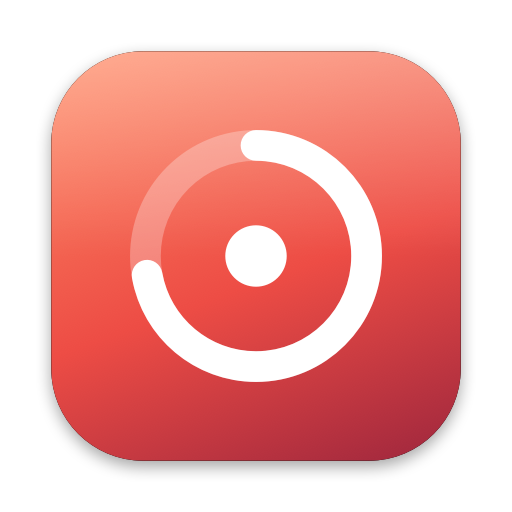
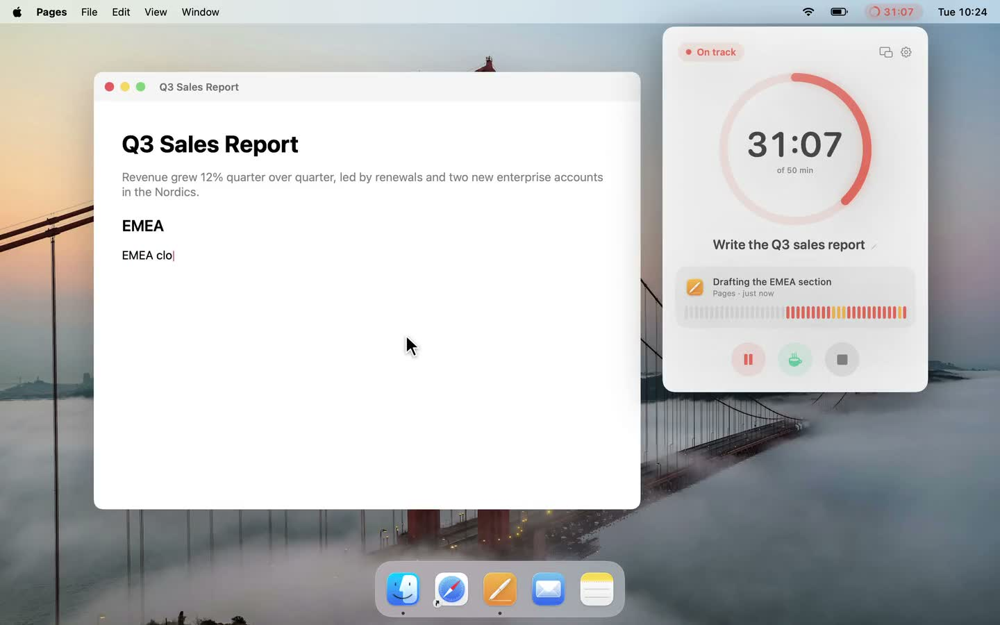
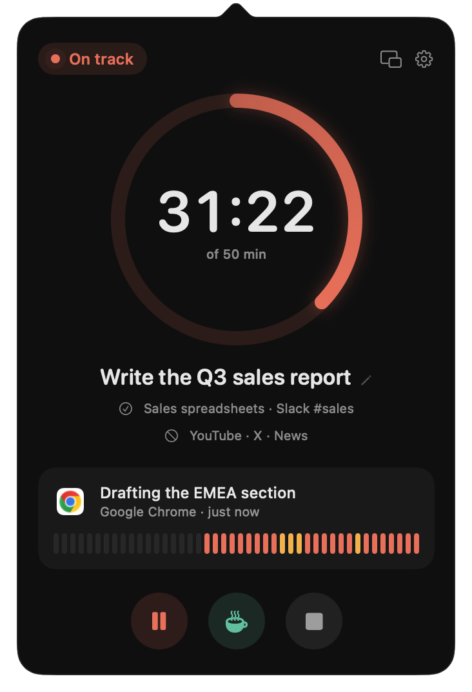
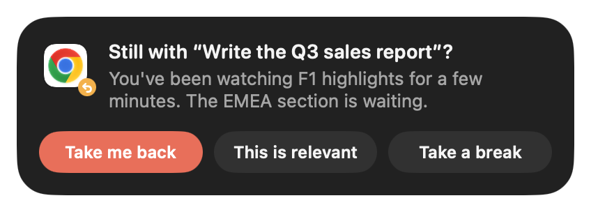

<p align="center">
  
</p>

<h1 align="center">Fokly</h1>

<p align="center">
  <b>Never be distracted again.</b><br>
  A focus timer for the Mac menu bar that notices when you get distracted and brings you back.<br>
  The AI that watches your screen runs entirely on your Mac.
</p>

<p align="center">
  <a href="https://github.com/jindratilk/fokly/releases/latest/download/Fokly.dmg"><b>Download for Mac</b></a>
  &nbsp;·&nbsp;
  <a href="https://fokly.app">Website</a>
  &nbsp;·&nbsp;
  macOS 27 · Apple silicon · Free and open source
</p>

<p align="center">
  
</p>

## How it works

1. **Tell Fokly what you're working on.** Click the ring in the menu bar (or press <kbd>⌃</kbd><kbd>⌥</kbd><kbd>Space</kbd>),
   type your goal and pick a length. Optionally list what also counts (*Slack #team, the docs*) and what never does (*YouTube, X*).
2. **Get to work.** Every 20 seconds Fokly checks the window in front of you: it reads the app, the window title
   and the text on screen, and a local AI model decides whether it serves your goal.
3. **Fokly reminds you.** Get distracted and the menu bar turns amber right away. If it lasts (two minutes by default), a quiet
   reminder slides in, written about what you're actually doing.
4. **One click and you're back.** *Take me back* returns you to the exact window and browser tab you were working in.
   *This is relevant* teaches the session that the activity counts. *Take a break* pauses without guilt.

<p align="center">
  
  &nbsp;&nbsp;
  
</p>

## Private by design

- **The model runs on your Mac.** Fokly uses Qwen3.5 (4B by default, 2B as a lighter option) through
  [MLX](https://github.com/ml-explore/mlx-swift), in-process, on the Apple silicon GPU. The weights are downloaded once
  from Hugging Face, pinned to an exact commit.
- **Nothing leaves your Mac.** No account, no cloud, no analytics. Screenshots and screen text are judged in memory and
  thrown away; only the session history (goal, times, app names) is kept, locally.
- **You can read every line.** That's the point of this repository.

Fokly needs two permissions: **Screen Recording** to see the window you're working in, and **Accessibility** so
*Take me back* can return you to the right window and tab. The first launch walks you through both.

## Install

Download [Fokly.dmg](https://github.com/jindratilk/fokly/releases/latest/download/Fokly.dmg), open it and drag Fokly to
Applications. It's signed with a Developer ID and notarized by Apple.

Requirements: macOS 27, an Apple silicon Mac, about 3 GB of disk for the model (the first session downloads it).

## Build from source

You need Xcode 27, [XcodeGen](https://github.com/yonaskolb/XcodeGen) and the Metal toolchain.

```sh
brew install xcodegen
xcodebuild -downloadComponent MetalToolchain
xcodegen generate
xcodebuild -project Fokly.xcodeproj -scheme Fokly -configuration Release \
  -derivedDataPath build -skipMacroValidation -skipPackagePluginValidation build
open build/Build/Products/Release/Fokly.app
```

The project signs with the maintainer's team (`DEVELOPMENT_TEAM` in `project.yml`). To build your own copy, set your
team there, or sign to run locally.

### Developer tools

Builds with the `DEVTOOLS` flag carry extra launch modes for testing and for the website and video assets. Release
builds never contain them.

```sh
xcodebuild … -derivedDataPath build-dev 'SWIFT_ACTIVE_COMPILATION_CONDITIONS=$(inherited) DEVTOOLS' build
build-dev/Build/Products/Release/Fokly.app/Contents/MacOS/Fokly --bench-acc mlx-community/Qwen3.5-2B-4bit report.md
```

| Flag | What it does |
| --- | --- |
| `--bench-acc <model> [report]` | Judges 38 labeled screens and reports accuracy, missed distractions and false alarms |
| `--bench <model> [report]` | The above plus live screen checks, latency and memory |
| `--stress [report]` | 600 random UI actions, panel churn, a real one-minute session |
| `--tour` | The onboarding tour |
| `--shots <dir>` · `--stills <dir>` | Screenshots of the real UI for the website and the launch video |

### Releasing

`scripts/release.sh` builds, verifies the signature and hardened runtime, packages a DMG, notarizes it and staples
the ticket. One-time setup:

```sh
xcrun notarytool store-credentials fokly-notary --apple-id <Apple ID> --team-id <Team ID>
```

## Project layout

```
Fokly/
  Core/      FocusController (session state, the observe → judge loop, distractions and reminders)
             ScreenObserver (active window via ScreenCaptureKit, Vision OCR, idle and lock detection)
             FocusJudge (MLX model loading, the prompt, parsing the verdict)
             WindowReturn (Take me back: back to the exact window and tab via Accessibility)
             HistoryStore, Models, Theme
  Panels/    Menu bar item and popover, the reminder panel, the floating timer, onboarding, permissions
  Views/     SwiftUI screens: start, active session, insights, settings
  App/       App entry point and the DEVTOOLS-only modes
site/        The website (static, deployed to Vercel)
scripts/     release.sh
project.yml  XcodeGen project definition
```

## Contributing

Issues and pull requests are welcome. If you change how Fokly judges the screen (`Core/FocusJudge.swift`), please run
`--bench-acc` on both the 4B and 2B models before and after and include the numbers.

## License

[MIT](LICENSE). The Qwen3.5 model weights are not part of this repository; they're downloaded from Hugging Face under
their own license (Apache 2.0). Website photos are from Unsplash (Leo_Visions, KC Welch); the Fleet Week footage is by
the U.S. Navy.
